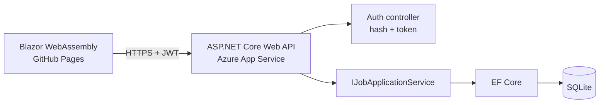

# 🎯 Job Hunt Tracker


> Because "Applied to 40 companies, remember none of them" is not a strategy.

A full stack job application tracker. Create an account, add applications, and move them across a
Kanban board: **Applied → Interview → Offer → Rejected**. Built during my own job search, so I'm the first user.

## 🔗 Live demo

**https://raghava503.github.io/JobHuntTracker/**

Register with any email and a throwaway password (8+ characters). Your board is private to your account.

> ⏳ The API runs on a free Azure tier that sleeps when idle, so the **first request can take 20 to 30 seconds**. After that it's fast.


## ✨ Features

- Register and log in with **JWT authentication**
- Every user sees **only their own** applications
- Add, move and delete applications on a Kanban board
- Passwords are salted and hashed, never stored in plain text
- Data is stored in a database and survives restarts
- Pushes to `main` build, test and deploy automatically

## 🧭 Architecture



The controller depends on an **interface**, so replacing the storage layer later means changing one line in `Program.cs`.
The in-memory version, the EF Core version and the per-user version are all in the Git history.

## 🧰 Tech stack

| Layer | Technology |
|---|---|
| Front end | Blazor WebAssembly (C#, no JavaScript framework) |
| API | ASP.NET Core Web API (controllers) |
| Data | Entity Framework Core + SQLite, with migrations |
| Auth | JWT bearer tokens, `PasswordHasher` |
| Hosting | Azure App Service (API), GitHub Pages (front end) |
| CI/CD | GitHub Actions |

## 🔌 API endpoints

| Method | Route | Auth | What it does |
|---|---|---|---|
| POST | `/api/auth/register` | No | Create an account, returns a token |
| POST | `/api/auth/login` | No | Log in, returns a token |
| GET | `/api/jobapplications` | Yes | List my applications (`?status=Interview` to filter) |
| GET | `/api/jobapplications/{id}` | Yes | Get one of mine |
| POST | `/api/jobapplications` | Yes | Add an application |
| PATCH | `/api/jobapplications/{id}/status` | Yes | Move it to another stage |
| DELETE | `/api/jobapplications/{id}` | Yes | Remove it |

Another user's application returns `404`, not `403`, so the API never confirms it exists.

## 🚀 Run it locally

You need the [.NET 10 SDK](https://dotnet.microsoft.com/download).

```bash
git clone https://github.com/raghava503/JobHuntTracker.git
cd JobHuntTracker

# One-time: set a signing key for JWTs (stored outside the repo)
dotnet user-secrets init --project JobHuntTracker.Api
dotnet user-secrets set "Jwt:Key" "<a long random string, 32+ characters>" --project JobHuntTracker.Api

# Terminal 1: API
dotnet run --project JobHuntTracker.Api --urls http://localhost:5100

# Terminal 2: front end
dotnet run --project JobHuntTracker.Web --urls http://localhost:5200
```

Open http://localhost:5200. The database file is created automatically on first run.

## ☁️ How it's deployed

- **API**: `dotnet publish` then deploy to Azure App Service, triggered when `JobHuntTracker.Api/**` changes
- **Front end**: `dotnet publish`, adjust the base path, then deploy to GitHub Pages, triggered when `JobHuntTracker.Web/**` changes
- **Secrets**: the JWT key and connection string live in Azure app settings, and the publish profile is a GitHub secret. Nothing sensitive is in the repo.

## 🧠 What I learned building this

- **Dependency injection**: why controllers ask for interfaces, and what Singleton, Scoped and Transient mean
- **EF Core**: `DbContext`, migrations, change tracking, `AsNoTracking`, and deferred LINQ execution
- **async/await**: freeing threads while the database works
- **Authentication vs authorization**: JWT structure, claims, token validation, and 401 vs 403 vs 404
- **Broken access control**: every query filters by the logged-in user's id
- **Secrets management**: user secrets locally, environment settings in the cloud, never in Git
- **CORS**: what the browser enforces and what the API has to allow
- **Blazor**: components, data binding, lifecycle, and calling an API from the browser
- **CI/CD**: separate pipelines per project with path filters
- **Cloud policies**: handling Azure region restrictions and hosting a single-page app under a sub-path

## ⚠️ Known limitations

- SQLite on free hosting is fine for a demo, but a production version would use a managed database such as Azure SQL
- The token is kept in `sessionStorage`, which scripts on the page can read. A safer design uses an `HttpOnly` cookie.
- No automated tests for this API yet, so I'd add service-layer and integration tests next

## 🗺️ Roadmap

- [x] CRUD API with validation
- [x] SQLite and Entity Framework Core
- [x] JWT authentication with per-user data
- [x] Blazor Kanban front end
- [x] Live deployment with CI/CD
- [ ] Unit and integration tests for the API
- [ ] Azure SQL instead of SQLite
- [ ] `HttpOnly` cookie authentication
- [ ] Interview dates and notes per application

## 👤 Author

**Raghava**: aspiring full stack .NET developer
[GitHub](https://github.com/raghava503) · [LinkedIn](https://linkedin.com/in/raghava-gudiwada-0b2bb4317)
