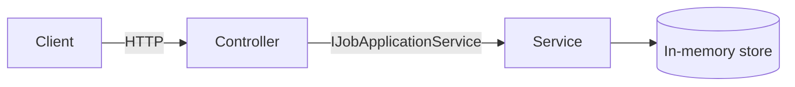

# 🎯 Job Hunt Tracker API


> Because "Applied to 40 companies, remember none of them" is not a strategy.

A REST API that tracks every job application through its life: **Applied → Interview → Offer → Rejected**.
I built it during my own job search, so I'm the first user.

## ✨ Features

- Add, list, filter, update and delete job applications
- Filter by stage: `GET /api/jobapplications?status=Interview`
- Input validation with clear `400` errors
- Clean layering: Controller → Service interface → Storage
- Runs on every push through GitHub Actions

## 🧭 How it works



The controller only knows the **interface**, so swapping the in-memory store for a
real database later means changing one line in `Program.cs`.

## 🚀 Run it

```bash
git clone https://github.com/raghava503/JobHuntTracker.git
cd JobHuntTracker
dotnet run --project JobHuntTracker.Api
```

## 🔌 Endpoints

| Method | Route | What it does | Success |
|---|---|---|---|
| GET | `/api/jobapplications` | List all (optional `?status=`) | 200 |
| GET | `/api/jobapplications/{id}` | Get one | 200 / 404 |
| POST | `/api/jobapplications` | Add an application | 201 |
| PATCH | `/api/jobapplications/{id}/status` | Move to the next stage | 200 / 404 |
| DELETE | `/api/jobapplications/{id}` | Remove it | 204 / 404 |

### Try it

```bash
curl -X POST http://localhost:5000/api/jobapplications \
  -H "Content-Type: application/json" \
  -d '{"company":"Contoso","role":".NET Developer"}'
```

```json
{
  "id": "3f2b8c1e-...",
  "company": "Contoso",
  "role": ".NET Developer",
  "status": "Applied",
  "appliedOnUtc": "2026-10-18T10:30:00Z"
}
```

## 🧠 What I learned building this

- **Dependency injection**: why the controller asks for an interface instead of calling `new`
- **Service lifetimes**: why Singleton fits in-memory storage and Scoped will fit EF Core
- **DTOs**: keeping clients away from fields they shouldn't control (`Id`, dates)
- **HTTP semantics**: `201 Created`, `204 No Content` and `404` all mean something
- **Thread safety**: why `ConcurrentDictionary` beats `Dictionary` in a web server

## 🗺️ Roadmap

- [x] CRUD API with validation
- [x] CI pipeline
- [ ] Unit tests for the service layer
- [x] SQLite + Entity Framework Core
- [ ] JWT authentication
- [ ] Blazor front end
- [ ] Deploy to Azure App Service

## 👤 Author

**Raghava**: aspiring full stack .NET developer
[GitHub](https://github.com/raghava503) · [LinkedIn](https://linkedin.com/in/raghava-gudiwada-0b2bb4317)